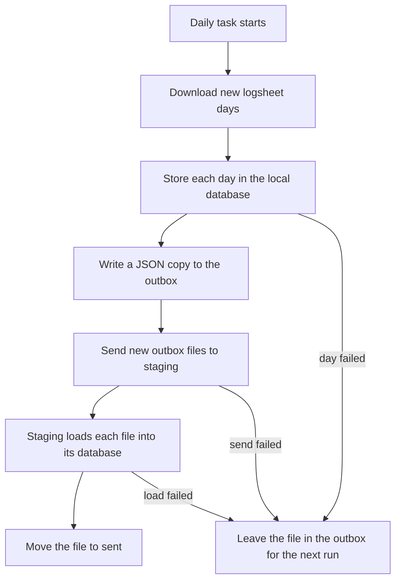

# Staging logsheet handoff

This PC downloads new logsheet days, stores them locally, and sends a copy to the staging API host (`172.28.92.57`). Staging loads that copy into its database.

The daily Windows task is **Plant Dashboard logsheet sync**.



## What the task does

1. It downloads any new days for sounding, oil movement, both production logs, tank analytical, refinery quality, and utility.
2. It stores those days in the database on this PC.
3. For each day that was stored, it writes a JSON file under `Docs/exports/staging-outbox`.
4. It copies those files to the API host and loads them into the staging database.
5. A loaded file moves to `Docs/exports/staging-outbox/sent`. A day or a send that failed stays in the outbox. The next run tries it again.

The daily run only downloads days after the newest workbook already saved on this PC. Logsheet username and password stay in `Frontend/.env.sync`.

## After a run

| What you want to know | Where to look |
| --- | --- |
| Download and local store | `Docs/exports/logsheet-sync/sync-report.txt` |
| Send to staging | `Docs/exports/staging-outbox/push-report.txt` |
| Still waiting to be loaded | JSON files directly under `Docs/exports/staging-outbox` |
| Already loaded | `Docs/exports/staging-outbox/sent` on this PC, and `/opt/plant-information-dashboard/staging-inbox/applied` on the API host |

## Run it again

Re-run the registered task:

```powershell
Start-ScheduledTask -TaskName "Plant Dashboard logsheet sync"
```

Or, from the `Frontend` folder, run the same job directly:

```powershell
node scripts/sync-and-push-staging.mjs
```

Both commands download any days still missing, store them locally, and send whatever is still in the outbox.

## Fill a date gap

From the `Frontend` folder, pass the first and last day to include:

```powershell
node scripts/sync-and-push-staging.mjs --from 2026-10-28 --to 2026-10-29
```

Use this once for days already saved on this PC that staging does not have yet. Set `--from` to the last date already on staging.

## Resend without downloading

Use this when the local store succeeded and only the copy or the staging load failed:

```powershell
node scripts/push-staging.mjs
```

## First-time setup

1. Copy `Frontend/.env.staging-push.example` to `Frontend/.env.staging-push`.
2. Give this PC an SSH key the daily task can use. Follow [SSH login for the daily task](#ssh-login-for-the-daily-task) below. The task runs as the Windows user who registers it, and it cannot type a password or a passphrase.
3. Register the daily task from the repo root. This also points an existing **Plant Dashboard logsheet sync** task at the send step:

```powershell
.\Frontend\scripts\install-logsheet-sync-task.ps1
```

The default time is 16:00. Pass another time to change it, for example `.\Frontend\scripts\install-logsheet-sync-task.ps1 18:30`. If this PC is off at that time, the task starts when the PC is next on.

4. On the API host, update the checkout so the load script is present:

```bash
cd /opt/plant-information-dashboard
git pull origin sit
```

The file it needs is `Backend/scripts/apply-staging-inbox.sh`. The `pid-api` container loads each JSON file with the database login it already has.

## SSH login for the daily task

Do these steps in PowerShell as the Windows user who owns **Plant Dashboard logsheet sync**. The private key stays on this PC. Only the public key is copied to `172.28.92.57`.

### 1. Create a key with no passphrase

```powershell
ssh-keygen -t ed25519 -f $env:USERPROFILE\.ssh\id_ed25519
```

When asked to overwrite an existing key, type `y` only if that key has never been installed on the server. Press Enter at both passphrase questions so the passphrase is empty.

In PowerShell, `-N '""'` does not mean an empty passphrase. It locks the key with two quote characters, and the daily task cannot unlock it.

### 2. Confirm the key is unlocked

```powershell
ssh-keygen -y -f $env:USERPROFILE\.ssh\id_ed25519
```

A line starting with `ssh-ed25519` must appear immediately, with no `Enter passphrase:` prompt. On this PC, `ssh-keygen -y` does not accept `-P`. That combination prints `Too many arguments.`

If a passphrase prompt appears, press `Ctrl+C` and create the key again with empty passphrase questions.

### 3. Install the public key on the API host

This is the only command that should ask for the root password. The password does not appear as you type.

```powershell
Get-Content $env:USERPROFILE\.ssh\id_ed25519.pub | ssh root@172.28.92.57 "mkdir -p ~/.ssh && chmod 700 ~/.ssh && cat >> ~/.ssh/authorized_keys && chmod 600 ~/.ssh/authorized_keys"
```

Success is a return to the `PS` prompt with no error text.

### 4. Prove the task can log in alone

```powershell
ssh -o BatchMode=yes root@172.28.92.57
```

A Linux prompt means the login worked. Type `exit`.

`Permission denied (publickey,password)` means the server does not have this public key yet, or step 3 did not finish. Do not send files until this command opens a shell without a password question.

### 5. Send files that are already waiting

From any folder:

```powershell
node "D:\Cursor\Plant Information Dashboard\Frontend\scripts\push-staging.mjs"
```

Then open `Docs/exports/staging-outbox/push-report.txt`.

| Result | Meaning |
| --- | --- |
| Status: OK, Sent: 15 (or whatever was waiting) | Those files were copied and loaded |
| Left in outbox: 0 | Nothing is still waiting |
| Files under `Docs/exports/staging-outbox/sent` | This PC has marked them as loaded |

On the API host, the same files are under `/opt/plant-information-dashboard/staging-inbox/applied`. A file still directly under `Docs/exports/staging-outbox` was not loaded. Run the push command again after SSH works. The download does not need to be repeated.
